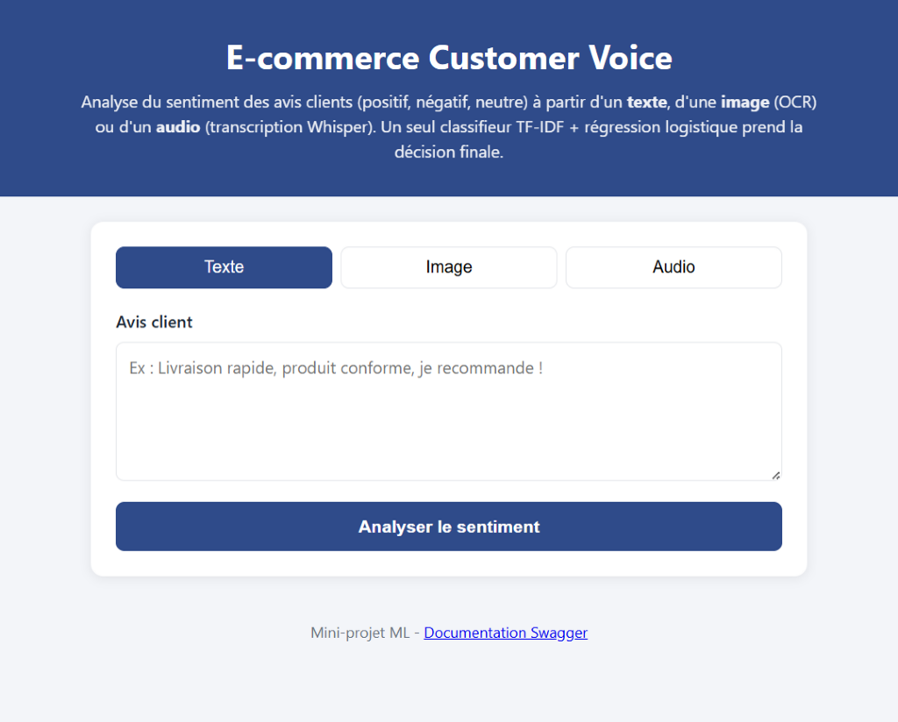
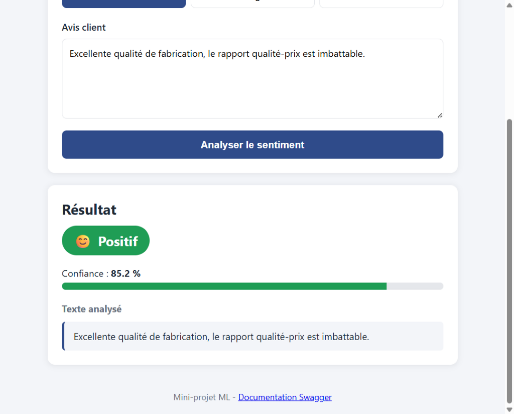
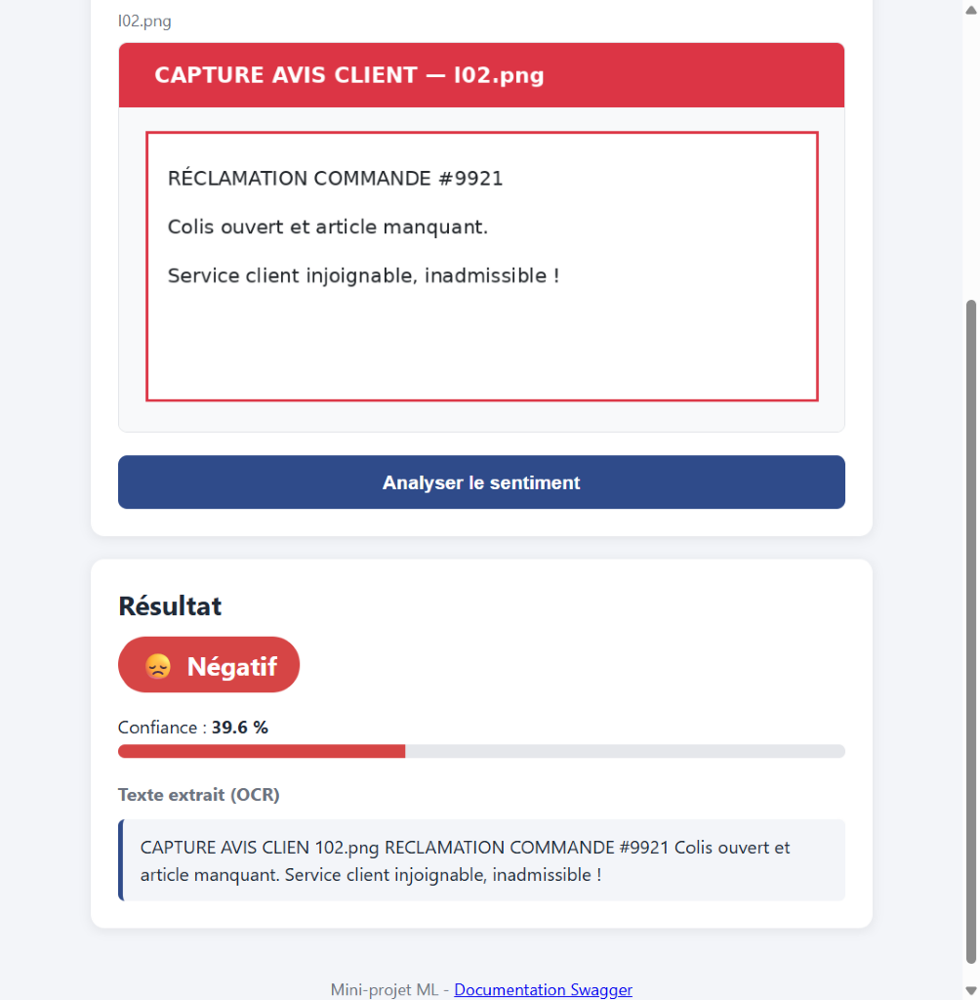
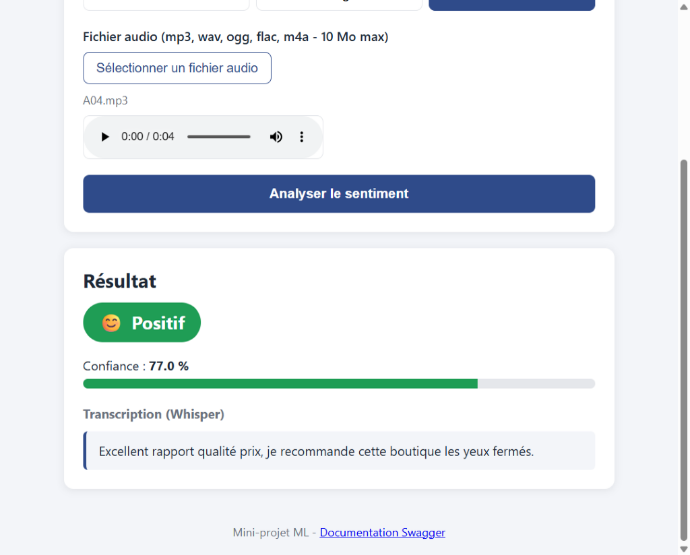
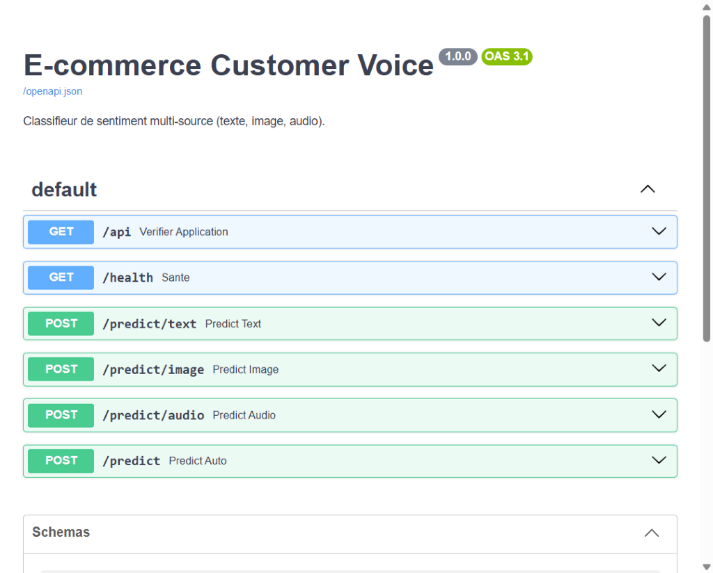

# E-commerce Customer Voice — Classifieur de sentiment multi-source

Mini-projet de Machine Learning : prédire le sentiment (**positif / négatif / neutre**) d'un avis client, que l'avis soit un **texte**, une **image** (capture d'écran) ou un **audio**.

## Objectifs pédagogiques
- Entraîner un classifieur de texte (TF-IDF + régression logistique) avec Scikit-learn.
- Combiner plusieurs modalités avec une **architecture en cascade**.
- Exposer le modèle avec une API REST (FastAPI) et une interface web.
- Tester l'API avec Pytest (OCR et ASR remplacés par des mocks **dans les tests uniquement**).

## Architecture en cascade
```
Texte -> Nettoyage -> TF-IDF -> Régression logistique -> sentiment
Image -> OCR (Tesseract) -> texte -> (même chaîne)       -> sentiment
Audio -> ASR (Whisper)   -> texte -> (même chaîne)       -> sentiment
```
Les trois modalités se terminent dans **le même modèle** (`models/sentiment_model.pkl`).

## Technologies
Python 3.12, Pandas, NumPy, Scikit-learn, Pillow, Pytesseract, faster-whisper (version légère de Whisper, CPU), FastAPI, Pydantic, Uvicorn, Pytest, HTTPX, HTML/CSS/JavaScript.

## Structure du projet
```
.
├── data/                      copie du dataset (textes.csv, images.csv, audios.csv, images/, audios/)
├── dataset_sentiment_ecommerce/   dataset ORIGINAL du professeur (non modifié)
├── models/sentiment_model.pkl     pipeline entraîné (TF-IDF + régression logistique)
├── app/
│   ├── main.py                routes FastAPI
│   ├── schemas.py             schémas Pydantic
│   ├── services/
│   │   ├── sentiment.py       nettoyage + chargement du modèle + prédiction
│   │   ├── ocr.py             image -> texte
│   │   ├── asr.py             audio -> texte
│   │   └── erreurs.py         erreurs -> codes HTTP
│   └── static/                index.html, style.css, script.js
├── scripts/train_model.py     entraînement et évaluation
├── tests/test_api.py          37 tests
├── requirements.txt
├── README.md / DEMO.md
```

## Analyse du dataset fourni
| Fichier | Contenu | Colonnes |
|---|---|---|
| `textes.csv` | 24 textes français (8 par classe) | `id, texte, sentiment_ref` |
| `images.csv` | 9 images PNG 820x440 | `fichier, texte_attendu_ocr, sentiment_ref` |
| `audios.csv` | 9 audios en français | `fichier, transcription_reference, sentiment_ref` |

Constats :
- Les `.csv` sont de vrais CSV UTF-8 (pas du XLSX). Pas de valeurs manquantes ni de doublons.
- Étiquettes : `positif`, `negatif` (sans accent), `neutre`.
- **Incohérence** : `audios.csv` cite `A01.wav`... mais les fichiers réels sont `A01.mp3` (vrais MP3).
- **Dataset très petit** (24 textes) : les scores sont peu fiables statistiquement.
- Les textes de `images.csv` / `audios.csv` ne servent **pas** à l'entraînement ; ils servent de test supplémentaire.

## Installation (Windows, PowerShell)
```powershell
# 1. Créer l'environnement virtuel (Python 3.10+ requis)
python -m venv .venv
# 2. L'activer (si bloqué : Set-ExecutionPolicy -Scope CurrentUser RemoteSigned)
.\.venv\Scripts\Activate.ps1
# 3. Installer les dépendances
pip install -r requirements.txt
# 4. Entraîner le modèle
python scripts/train_model.py
# 5. Lancer l'API
python -m uvicorn app.main:app --reload
```
- Interface web : http://127.0.0.1:8000/
- Swagger : http://127.0.0.1:8000/docs
- Tests : `python -m pytest -v`

### Installations supplémentaires
**Tesseract OCR (obligatoire pour l'image)** — programme Windows séparé :
1. Télécharger l'installeur « UB Mannheim » : https://github.com/UB-Mannheim/tesseract/wiki
2. À l'installation, cocher la langue **French** (`fra`).
3. Chemin habituel : `C:\Program Files\Tesseract-OCR\tesseract.exe` (détecté automatiquement). Sinon :
   `$env:TESSERACT_CMD = "C:\chemin\vers\tesseract.exe"` avant de lancer uvicorn.
4. Sans le pack `fra`, l'application utilise l'anglais (accents moins bien lus).

**Whisper (audio)** — installé via `faster-whisper` (aucun FFmpeg nécessaire, MP3 lu par PyAV).
Au **premier appel audio**, le modèle `base` (~150 Mo) est téléchargé depuis Internet. Un autre modèle peut être choisi : `$env:WHISPER_MODEL = "small"`.
Les tests n'ont pas besoin d'Internet ni de Tesseract.

## Endpoints
| Route | Entrée | Rôle |
|---|---|---|
| `GET /` | — | Interface web |
| `GET /api` | — | Vérifie que l'application fonctionne |
| `GET /health` | — | État du modèle, de l'OCR et de l'ASR |
| `POST /predict/text` | JSON `{"text": "..."}` | Prédiction sur texte |
| `POST /predict/image` | multipart `file` | OCR puis prédiction |
| `POST /predict/audio` | multipart `file` | ASR puis prédiction |
| `POST /predict` | JSON **ou** multipart `file` | Détection automatique du type |

Codes : 200 succès · 422 requête/contenu invalide (vide, illisible, sans texte, ambigu) · 413 fichier trop gros (image 5 Mo, audio 10 Mo) · 415 format non pris en charge · 503 Tesseract/Whisper indisponible.
Le type réel est vérifié via les premiers octets du fichier, pas seulement l'extension.

Exemple :
```powershell
curl.exe -X POST http://127.0.0.1:8000/predict/text -H "Content-Type: application/json" -d '{\"text\": \"Le produit est excellent\"}'
curl.exe -X POST http://127.0.0.1:8000/predict/image -F "file=@data/images/I01.png;type=image/png"
curl.exe -X POST http://127.0.0.1:8000/predict/audio -F "file=@data/audios/A01.mp3;type=audio/mpeg"
```
Réponse (structure commune) : voir la section « Exemples réels » ci-dessous.

## Résultats réels de l'évaluation
(sortie de `python scripts/train_model.py`, graine 42)

**Jeu de test (6 textes, split stratifié 75/25)** : accuracy **0.50**, F1 macro **0.43**.
Matrice de confusion (ordre negatif, neutre, positif) : `[[1 1 0] [1 0 1] [0 0 2]]` — la classe *neutre* n'est jamais reconnue sur ce test.
Validation croisée 4 plis : accuracy moyenne **0.29**.

**Textes de référence des images (9, non utilisés pour l'entraînement)** : accuracy **0.78**, F1 macro **0.78**.
**Textes de référence des audios (9)** : accuracy **0.89**, F1 macro **0.89**.

Ces chiffres supposent un OCR/ASR parfait. Avec 24 exemples, ils varient beaucoup et ne prouvent pas une bonne généralisation. Le modèle final sauvegardé est ré-entraîné sur les 24 textes.

## Résultats réels de bout en bout (OCR et ASR réels)
Mesurés avec le modèle final, Tesseract 5.4 (langue `fra`) et Whisper « base » (`python scripts/test_ocr_dataset.py`, `python scripts/smoke_test.py`) :

| Modalité | Fichiers | Sentiments corrects | Remarque |
|---|---|---|---|
| Image (OCR) | 9 | **7 / 9** | I01 (positif) prédit neutre, I09 (neutre) prédit négatif |
| Audio (ASR) | 9 | **8 / 9** | A05 (négatif) prédit positif |

- Le texte OCR est presque parfait (mots corrects à 93-100 %). Les images contiennent un bandeau « CAPTURE AVIS CLIENT — Ixx.png » qui est lu aussi ; les symboles ★ ne sont pas lus. Les accents sont parfois remplacés (é → e).
- Whisper fait quelques erreurs (« Collier » au lieu de « Colis »).
- La **confiance** est souvent basse (0,38 à 0,77) : le modèle est peu sûr. Exemple d'erreur : « Le produit est excellent » est classé **neutre** (0,45).
- Les résultats complets sont dans `docs/resultats_ocr_images.txt`.

## Pistes d'amélioration étudiées
`python scripts/compare_models.py` compare 12 réglages (mots seuls ou paires, avec ou sans stop-words, C = 1, 10, 100) avec une validation croisée répétée (4 plis x 10) sur les 24 textes. Résultat : **toutes les variantes donnent 0,26 à 0,30** de validation croisée, sans différence significative. Les écarts sur les textes images/audios (0,78 à 0,89) ne sont pas un critère fiable avec seulement 18 exemples. **Aucun réglage n'a donc été changé** (choisir le meilleur sur ces 18 textes fausserait l'évaluation). La vraie amélioration serait d'obtenir **beaucoup plus de textes annotés** ; je n'en ai pas fabriqué.

## Captures d'écran
Captures réelles prises dans un navigateur sur l'application lancée (dossier `docs/`). Le texte « Excellente qualité… » est un exemple du dataset d'entraînement.

1. Interface web : `docs/01_interface_web.png`
2. Prédiction textuelle : `docs/02_prediction_texte.png` (positif, 85,2 %)
3. Prédiction image (I02.png) : `docs/03_prediction_image.png` (négatif, 39,6 %)
4. Prédiction audio (A04.mp3) : `docs/04_prediction_audio.png` (positif, 77,0 %)
5. Swagger : `docs/05_swagger.png`
6. Résultats des tests : sortie réelle de pytest enregistrée en **texte** (pas en image) dans `docs/resultats_tests.txt` (37 passed). Tu peux refaire une capture de ton terminal avec `python -m pytest -v`.







## Limites connues
- Dataset minuscule (24 textes) : validation croisée ≈ 0,29, soit en dessous du hasard (0,33). Le modèle apprend surtout des mots précis et généralise mal ; la classe « neutre » est difficile.
- Les exemples du dataset utilisés en démonstration sont des textes d'entraînement : une confiance élevée sur ces textes (ex. 85 %) ne prouve pas que le modèle généralise.
- Vocabulaire limité : un mot absent du dataset est ignoré.
- Qualité dépendante de l'OCR (images bruitées, bandeau lu aussi) et de Whisper (accent, bruit).
- Langue française uniquement (Whisper forcé en `fr`, stop-words français).
- Les tests Pytest utilisent des mocks pour OCR/ASR : ils ne valident pas la qualité réelle. La qualité réelle est mesurée par `scripts/test_ocr_dataset.py` et `scripts/smoke_test.py`.
- Le premier appel audio télécharge le modèle Whisper (Internet nécessaire).
